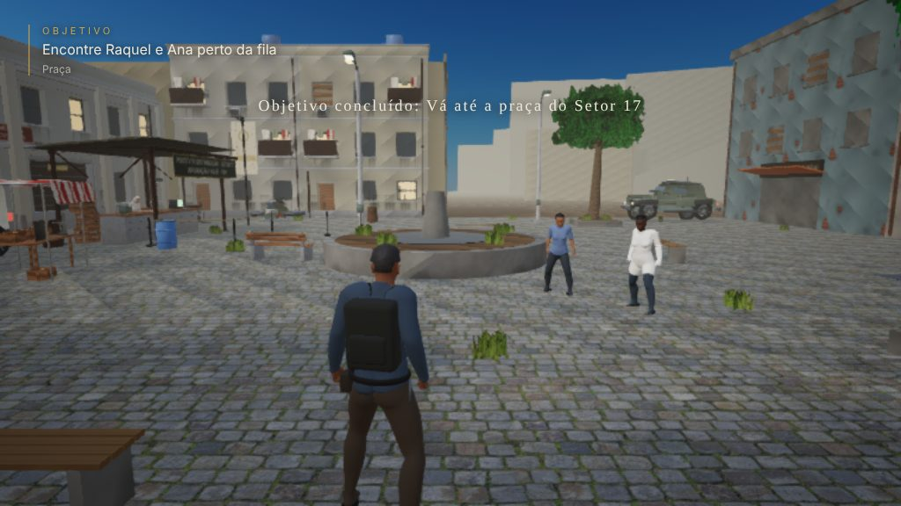

# O Último Veto — EVA

Jogo **3D narrativo para navegador**, com exploração em terceira pessoa, mistério tecnológico e drama político/religioso no Brasil de 2072.

> **Estado:** protótipo **M0 jogável** do prólogo *A Apuração* (São Paulo Velha, Setor 17). Detalhes, pendências e assets provisórios em [`docs/STATUS.md`](docs/STATUS.md).



## Identidade

- **Protagonista:** Matias (apenas Matias), engenheiro de segurança e ex-colaborador do projeto EVA.
- **Tema:** uma inteligência artificial fisicamente isolada se torna objeto de adoração por comunidades humanas após um colapso de infraestrutura.
- **Tom:** realista, dramático, investigativo e moralmente ambíguo. **Não** copiar personagens ou história de *The Last of Us*.
- **Mundo:** não é um deserto de ruínas. Existem cidades ativas, comércio, agricultura, eletricidade em parte dos territórios, religião, castas e disputas políticas.
- **Primeira missão:** **A Apuração**, em São Paulo Velha.

## Stack

- **Babylon.js 9** + **TypeScript** (estrito) + **Vite 8** — WebGL 2.
- **Havok** (`@babylonjs/havok`, WASM) — física, colisão e `PhysicsCharacterController`.
- **glTF/GLB** — personagens rigados (rig Mixamo, 52 ossos) gerados em Blender headless a partir de dados CC0 do MakeHuman (`tools/blender/make_character.py`), com animações reais da **Quaternius Universal Animation Library** (CC0) retargeteadas por `tools/blender/retarget.py`.
- **Web Audio** — áudio espacial (HRTF); passos e impactos gravados (Kenney, CC0) por superfície, ambiente/interface sintetizados; **Web Speech API** como voz provisória.
- **IndexedDB** — salvamento local com esquema versionado.
- **yuka** 0.7 (MIT) — steering, separação e desvio de obstáculos da IA dos inimigos.
- Código portado com crédito: `RaycastVehicle` do **cannon-es** (MIT; derivado do `btRaycastVehicle` do Bullet, zlib) em `src/vehicles/raycastVehicle.ts`; controle de voo inspirado no helicóptero do **Sketchbook** (swift502, MIT) em `src/vehicles/hoverBike.ts`.
- **Vitest** (lógica, GLB, física headless) + **Playwright/Chromium** (teste visual com screenshots).
- **Docker** (Node build → Nginx) — pronto para Easypanel.

## Executando

```bash
npm install          # Node 20+ (testado com Node 22)
npm run dev          # http://localhost:5173
```

Build de produção e pré-visualização:

```bash
npm run build        # gera dist/
npm run preview      # http://localhost:4173
```

Parâmetros opcionais na URL: `?quality=baixa|media|alta` força a qualidade gráfica (ex.: `http://localhost:5173/?quality=baixa` em máquinas fracas); `?pointerlock=0` nunca trava o cursor (câmera por arrasto do mouse); `?touch=1|0` força/desliga os controles de toque.

### Controles

| Tecla | Ação |
| --- | --- |
| Mouse | Câmera (clique na cena para travar o cursor; se o navegador recusar — p. ex. dentro de um iframe — arraste com o botão esquerdo) · roda = distância |
| W A S D / setas | Andar (a pé) · acelerar/frear/ré e virar (veículos) · empuxo e deslocamento lateral (aeromoto — a guinada segue o mouse) |
| Shift | Correr (5 m/s; após ~1 s em linha reta no plano engata o **embalo**, 7,2 m/s) · turbo na aeromoto |
| C (alterna) · Ctrl (segurar) | Agachar · **correndo: deslizar** (passa sob obstáculos baixos; Espaço no deslize emenda um pulo) · Ctrl = descer na aeromoto |
| Espaço (a pé) | **Pular** · no ar, de novo: **pulo duplo** (tempo de coiote e buffer de pulo perdoam o aperto um pouco cedo/tarde) |
| Q | **Esquivar**: rolamento no chão · **impulso no ar** (uma vez por salto) · recarga de 1,1 s |
| E | Interagir (rádio, cartão, NPCs, itens) · **entrar/sair de veículos** |
| Botão direito do mouse | Mirar (câmera no ombro; Matias encara a mira) |
| Botão esquerdo | Atirar (um tiro por clique) |
| R | Recarregar |
| I | Mochila (itens) |
| H | Usar kit médico |
| F | Faróis do veículo |
| Espaço (diálogo/veículo) | Avançar fala · freio de mão (carros) · subir (aeromoto) — nesses contextos não pula |
| 1–4 · setas + Enter · clique | Escolher resposta |
| Tab | Mostrar descrição da missão |
| Esc | Pausa (salvar, opções, voltar ao menu) |

**Veículos jogáveis**: Javali VB-4 (viatura blindada, praça leste), Módulo V-7 (van, junto ao portão da Central), Atlas T-3 (triciclo de carga, em frente à barraca do mercado) e Rastro AV-4 (aeromoto, praça leste — voa: Espaço sobe, Ctrl desce, W/S empuxo, A/D guinada, Shift turbo). Aproxime-se da porta e pressione **E**.

**Pilotagem da Rastro**: a moto vira para onde a câmera olha; **W com a câmera apontando para cima sobe, para baixo desce** (zona morta pequena), Espaço/Ctrl forçam subir/descer, A/D deslocam de lado, Shift é turbo (2× subida, 1,5× velocidade). **Céu sem teto**: a Rastro sobe o quanto o ar permitir. Acima de ~45 m ela entra em voo livre (o comando vertical pede velocidade de subida, que cresce com a altitude e com o turbo), a poeira da rua some, o céu escurece até o espaço, aparecem estrelas e a curvatura da Terra; acima de 60 km os rotores perdem sustentação e a ~100 km não há mais empuxo (a aeromoto volta a cair). Perto do chão há uma cerca invisível a ~170 m do quarteirão; quanto mais alto, mais longe se pode ir. Só é possível descer da aeromoto pousada (Ctrl). Capturas: `docs/screenshots/altitude/`.

**Missão (vertical slice, ~10–15 min)**: acordar na oficina → percorrer a rua e falar com os moradores → Raquel e Ana → a Apuração com Miriam → o Custódio revela que o lote sai ao anoitecer → **confronto** com desviadores em duas levas (pistola, mira, recarga, kit médico) → **fuga** com a van Módulo V-7 até a oficina → trancar o carregamento → decisão final pelo rádio. Matias pode cair: a tela "Matias caiu" devolve ao último ponto (junto à van) e a onda recomeça. O progresso é salvo automaticamente (IndexedDB).

### Capítulo 1 — como jogar

Depois de "O Carregamento", **Continuar explorando** na tela de conclusão amanhece o dia 2 (um jogo salvo nesse ponto amanhece direto ao carregar). O objetivo atual fica no canto da tela; **I** abre a mochila e a aba **Pistas** (diário); **E** examina objetos com prompt "Examinar/Ler…".

1. **Rastro do Lote (manhã)** — fale com Raquel na van diante da oficina e examine o manifesto e os lacres; vá ao portão da Central (Custódio) e ao depósito da zona de distribuição (norte do setor; se o portão estiver fechado, a grade dos fundos, do lado leste, passa **agachado**); examine as caixas atrás dos sacos e o caderno no escritório; pergunte ao comerciante da **feira do viaduto** (avenida, a leste); pegue o **Atlas T-3** ao lado da banca, encoste na van da oficina para carregar as caixas e leve ao posto da praça antes do prazo; escute Brandão e decida.
2. **A Vigília (noite)** — volte à oficina: o rádio chama. Quando o toque de recolher começar, vá à quadra da escola (ao sul, pela praça → Largo → rua da Escola) **sem ser visto**: agachado (C/Ctrl) os passos somem a 4 m; correndo, a 15 m; fuja das lanternas. Pego pelos Custódios, Matias volta ao último ponto. Na quadra, fale com Elias e examine a folha na bancada; depois suba ao telhado da escola (escada do lado do pátio), entre na Rastro e voe baixo até a rua da oficina.
3. **Partida (amanhecer)** — o bairro reflete suas escolhas (quadro de avisos da praça: água e caixas; tabela da banca: preços). Fale com Miriam, com o Custódio no portão, com Raquel e com Ana — **ela decide** se vai. Entre na van e siga para o posto de controle norte (fim da avenida).

`npm run test:cap1` (depois de `npm run build`) joga o capítulo inteiro no Chromium headless.

**Celular/tablet** (detectado automaticamente; `?touch=1` força, `?touch=0` desliga): joystick virtual flutuante na metade esquerda da tela (empurrar até a borda = correr), arrastar na metade direita gira a câmera, botões **E** (interagir/entrar — acende quando há algo à frente), **Agachar** (alterna; correndo, desliza), **Correr** (trava), **Pular** e **Esquivar** (só a pé), **Pausa** e, quando Matias está armado, **Mirar** (trava), **Atirar** (segurar) e **R** (recarregar); toque curto na tela avança as falas; tocar no objetivo mostra a descrição da missão. Sem configuração salva, o celular começa em qualidade **baixa** (mude em Opções). Jogue na horizontal; o navegador tenta entrar em tela cheia ao iniciar.

### Validação

```bash
npm run typecheck         # tsc --noEmit
npm test                  # testes Vitest: GLB, Havok headless, movimento de ação (pulo/esquiva/deslize), diálogo, missões, save, áudio, joystick
npm run build
npm run check             # os três acima
npm run test:visual   # abre dist/ em Chromium headless (teclado + mouse), joga o fluxo e salva docs/screenshots/*.jpg
npm run test:touch    # emula um celular na horizontal (só toques) e salva docs/screenshots/1x-celular-*.jpg
```

Os testes em navegador precisam do Playwright com Chromium (`npm i -D playwright && npx playwright install chromium`, ou um Playwright global). Sem GPU eles usam SwiftShader (poucos FPS, mas o fluxo completo é verificado). O teste visual abre o jogo com `?pointerlock=0` porque, no Chromium headless com SwiftShader, o pointer lock ativo deixa cada frame 5–10× mais lento (artefato do ambiente); `--lock` testa o caminho com cursor travado.

### Regenerar os personagens

```bash
/usr/bin/python3.11 -m pip install bpy==4.5.1   # Blender como módulo Python (Python 3.11)
npm run assets:characters      # Blender headless: morfa, veste, retargeteia as animações e escreve public/assets/characters/*.glb + characters.json; valida (Khronos)
npm run assets:preview         # renderiza docs/screenshots/characters/matias_*.jpg (Cycles)
npm run capture:video          # grava docs/videos/locomocao.mp4 (andar/correr/agachar/pegar) com quadros determinísticos a 30 fps e mede o deslizamento dos pés
npm run capture:praca          # grava docs/videos/praca_hero.mp4 (passeio pelo hero corner da praça)
npm run capture:altitude       # capturas da aeromoto a 300 m, 3 km, 12 km, 40 km e 90 km (docs/screenshots/altitude/)
npm run assets:environment     # regenera o kit GLB da praça (tools/blender/make_environment.py → public/assets/environments/praca_hero.glb)
npm run assets:vehicles        # valida os GLB-fonte dos veículos (PR #1) e gera os refinados em public/assets/vehicles/
npm run test:vehicles          # veículos como props/visualizador (preview-veiculos.html)
npm run test:gameplay          # fatia vertical no build: dirigir (Javali), voar (Rastro), combate (mira, tiro, recarga, dano), missão completa até a tela final
npm run test:gameplay -- --only missao   # só combate e missão (mais rápido); --shots <pasta> salva capturas
npm run test:gameplay -- --only movimento   # pulo, pulo duplo, esquiva + recarga, impulso no ar, embalo, deslize sob barra baixa, queda de 6 m
python3.11 tools/blender/retarget.py --library assets-src/animations/ual-standard/standard/Unreal-Godot/UAL1_Standard.glb --target public/assets/characters/matias.glb --clips movimento --anim-only --out public/assets/characters/matias_movimento.glb   # biblioteca de movimento (só armadura + clipes)
node tools/shot.mjs --out docs/screenshots/x.jpg --cam 24.5,2.4,3 --at 34,1.6,12.5 --player 29,0.22,7,0.9   # screenshot A/B com câmera fixa
```

Os dados-fonte (malha hm08, targets, rig Mixamo, máscaras, olhos) são CC0 do MakeHuman, vendorizados em `tools/blender/data/makehuman/`. As animações vêm da Quaternius Universal Animation Library v3 Standard (CC0, `assets-src/animations/`); o retarget (`tools/blender/retarget.py`) alinha quadros canônicos por osso e transfere as rotações no espaço do mundo, então funciona apesar das poses de descanso e proporções diferentes. Para usar outra animação da biblioteca, acrescente-a a `GAME_CLIPS` e a `ANIMATION_CLIPS`. Os clipes do movimento de ação (pulo, aterrissagem, rolamento, embalo) ficam à parte: `MOVEMENT_CLIPS` no retarget e em `src/data/characters.ts`, exportados só com a armadura em `<personagem>_movimento.glb` (hoje só `matias_movimento.glb`) e ligados aos ossos por nome em tempo de execução (`src/player/movementClips.ts`) — os GLBs dos personagens e o manifesto não mudam.

## Docker / Easypanel

```bash
docker build -t eva-game .
docker run --rm -p 8080:80 eva-game    # http://localhost:8080
```

No Easypanel: serviço do tipo *App* apontando para este repositório com build por **Dockerfile**; porta interna **80**. O servidor é estático (Nginx), sem backend, sem variáveis de ambiente obrigatórias.

## Estrutura

```text
public/assets/characters/   GLB rigados (humanos MakeHuman CC0 + animações UAL CC0) + manifesto
assets-src/animations/      fonte das animações (Quaternius UAL Standard, CC0) e mapeamento
assets-src/audio/           licença dos efeitos gravados (Kenney Impact Sounds, CC0)
public/assets/audio/sfx/    passos por superfície e impactos (.ogg) + licença
public/assets/licenses/     ASSETS.md — origem e licença de cada asset
src/core/                   boot, loop, input, configurações, orquestração (game.ts)
src/world/                  materiais e texturas procedurais, rua, prédios, oficina, praça, props, luz/céu
src/physics/                carregamento do Havok
src/player/                 controlador de personagem (Havok) e câmera em terceira pessoa (a pé, mira, veículo)
src/characters/             carregamento de GLB, animador (cross-fade + camadas tronco/pernas), NPC
src/vehicles/               veículos jogáveis: raycast vehicle (Havok), aeromoto, definições, entrar/sair
src/combat/                 armas, vida, efeitos (clarão, traçante, impacto), combate de Matias (mira/tiro/recarga)
src/ai/                     inimigos (FSM patrulha→alerta→perseguição→ataque, steering yuka, tiros) e gerenciador
src/items/                  mochila e itens no chão (munição, kit médico)
src/narrative/              flags, diálogos, missões, diretor da missão "O Carregamento"
src/data/                   diálogos PT-BR, missões, metadados de personagens
src/audio/                  motor Web Audio, sintetizador de sons, voz
src/ui/                     HUD, menus e controles de toque
src/persistence/            IndexedDB e sistema de save
tests/                      unit, assets, integration (física headless)
tools/                      geradores Blender (personagens, kit da praça, veículos, props), validadores, testes em navegador (visual, toque, veículos, gameplay), capturas
docs/                       bíblia canônica, prólogo, arquitetura, STATUS, screenshots
```

## Documentos de produção

- [Bíblia canônica](docs/UNIVERSO_CANONICO.md)
- [Prólogo A Apuração](docs/PROLOGO_A_APURACAO.md)
- [Arquitetura e pipeline de assets](docs/ARQUITETURA.md)
- [Status e pendências](docs/STATUS.md)
- [Manifesto de assets e licenças](public/assets/licenses/ASSETS.md)
- [Regras para agentes de código](CLAUDE.md)

## Assets e licenças

Os personagens são gerados pelo próprio projeto a partir de dados CC0 (MakeHuman), animados com a Quaternius Universal Animation Library (CC0) e os passos/impactos são gravações Kenney (CC0). Continuam **provisórios**: pele/cabelo/roupa procedurais, texturas procedurais, sons de ambiente/interface sintetizados, voz por síntese do navegador. Nenhuma marca comercial nas roupas; a foto de referência do criador não está no repositório. Veja [`public/assets/licenses/ASSETS.md`](public/assets/licenses/ASSETS.md) para a tabela completa e [`docs/STATUS.md`](docs/STATUS.md) para as ferramentas externas previstas para substituí-los (Blender, Mixamo, Poly Haven, dublagem).
