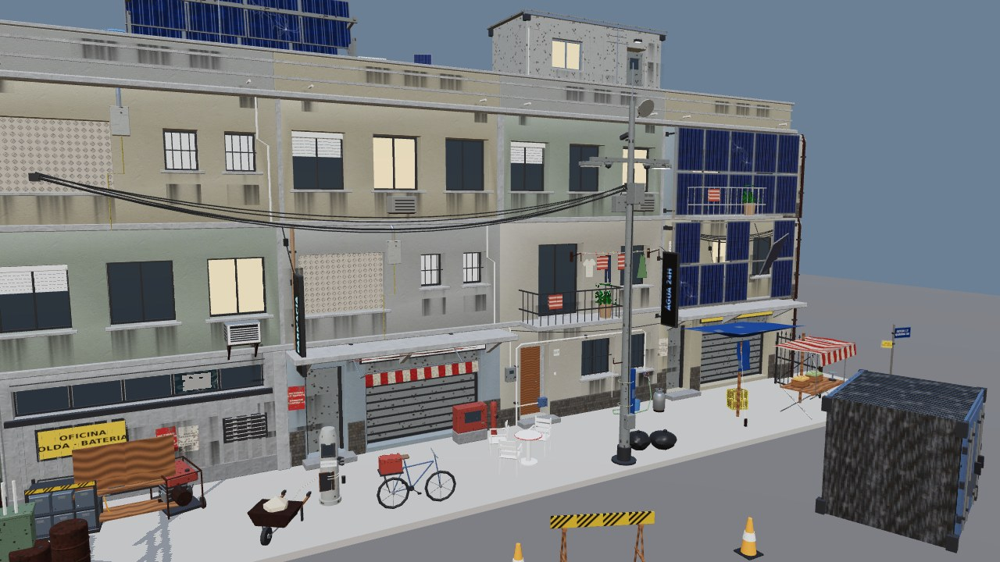

# KIT TECH 2072 — kit modular das três camadas

Arquivo: `public/assets/environments/kit_tech.glb` (4,9 MB, 56 peças, 36 K triângulos, 74 materiais PBR, 42 texturas ≤ 1024 px).
Gerador: `tools/blender/make_kit_tech.py` (Blender 4.5 headless, reaproveita primitivas/materiais de `make_environment.py`).
Visualizador: `kit-tech.html` → `src/dev/previewKit.ts` (`npm run dev` e abrir `/kit-tech.html`; `?demo=1` monta o quarteirão).
Teste: `npm run test:kit` (validador Khronos, orçamento por peça, texturas, colisores, capturas em `docs/screenshots/kit_tech/`).

Objetivo (DIRECAO_ARTE.md, "Regra das três camadas"): acabar com o aspecto "caixa com textura". Cada rua
mostra **base antiga** (até 2040) → **camada tecnológica** da Década dos Milagres (2043–2056) → **remendos**
(2057–2072), com um **marco monumental** por quarteirão. Este kit é matéria-prima: o agente de **Mapas**
instancia as peças em `src/world/*` (este kit não posiciona nada no mundo).



## Convenções de encaixe

- **Unidades**: metros. **Frente**: +Z no glTF/Babylon (−Y no Blender), igual ao `praca_hero.glb`.
- **Origem**: no chão, no centro da peça, **na linha da fachada** (plano z=0). A parede do módulo ocupa
  z ∈ [−0,5, 0]; tudo o que avança para a rua (marquise, sacada, pele fotovoltaica, toldo) fica em z > 0.
  Exceções, documentadas na coluna "Descrição": `REMENDO_fiacao_*` e `REMENDO_varal` têm a origem na
  **altura de fixação** (z=0 da peça = ponto onde o cabo/corda prende; a peça pende para baixo);
  `REMENDO_ar_condicionado` tem a origem na base traseira do aparelho, encostada na parede.
- **Módulo de fachada** = 6 m de largura × 1 pavimento (3 m). Encaixe lateral a cada 6 m, vertical a
  cada 3 m: `FACHADA_terreo_*` no chão, `FACHADA_apto_*` em y = 3k, `FACHADA_topo_*` em y = 3n (1,14 m de
  coroamento; a variante 1 tem telhado de telha ondulada e antena por trás). `FACHADA_esquina_*` é uma
  coluna 0,7 × 0,7 centrada na origem: coloque no encontro de dois módulos a 90° (cobre a junta e
  sobressai 10 cm das duas faces); empilhe uma por pavimento.
- **Variantes de cor**: sufixo `_0`/`_1` (rebocos areia/quente × verde/rosa/azul/cinza). Misturar
  variantes e tipos em cada pavimento quebra a repetição.
- **Camada tecnológica**: `TECH_pele_fotovoltaica_*` tem exatamente 6 × 3 m e se coloca na **mesma
  posição** de um módulo de fachada (os trilhos ficam 45 cm à frente da parede). `TECH_canopy_solar`,
  `TECH_anexo_modular`, `TECH_reciclador_agua` e `REMENDO_caixa_dagua` são peças de **laje**: coloque no
  topo do volume (y = altura do prédio). `TECH_letreiro_led_*` é bandeira perpendicular à fachada
  (origem na base do letreiro, no plano da parede). `TECH_poste_sensor` (9 m) vai no meio-fio.
- **Remendos**: `REMENDO_lona`, `REMENDO_toldo`, `REMENDO_tubo_agua` encostam na parede (origem no chão no
  plano z=0). `REMENDO_fiacao_6m/12m` vão ao longo de x entre dois pontos de fixação (poste ↔ poste ou
  fachada ↔ fachada); gire para cruzar a rua.
- **Marcos**: `MARCO_viaduto_maglev` tem o tabuleiro de x = −12 a x = +12 (pilar no centro) — para a
  sequência, repita a cada 24 m no mesmo eixo. `MARCO_torre_fazenda` ocupa 12 × 12 m com a fachada
  frontal (hall de vidro) em z = 0 e o volume para trás (z < 0); o topo fica aberto para continuação.
- **Colisores**: malhas `COL_*` (caixas) dentro de cada peça, prontas para `heroAssets.ts` →
  `ctx.staticBoxCollider`. Fiação, varal, toldo, letreiro e ar-condicionado não têm colisor (ficam fora
  do alcance do jogador).
- **Materiais**: PBR metal/roughness; texturas CC0 da ambientCG (reboco, concreto, pedra, telha, ferrugem) e
  procedurais (PIL) para painel fotovoltaico (cor + normal + rugosidade), chapa pintada (cor + normal),
  LED (cor + emissivo, `KHR_materials_emissive_strength`), lona, cobogó/vidro/roupas/engradado (alpha
  **MASK**), cartazes e placas com texto fictício (DejaVu Sans). Manchas de escorrido são planos alpha
  BLEND colados a 4 mm da parede. Cada peça é unida por material: 1 draw call por material.
- **Sombras**: em `heroAssets.ts` o filtro `/mancha|lona|vidro|fio|cabo/` já exclui dos casters os planos
  finos; acrescente `folhas|mato|roupa` para este kit.

## Catálogo

### Fachadas (base antiga, até 2040) — 16 peças

| Peça | L × A × P (m) | Tri | Draw calls | COL_ | Descrição |
| --- | --- | --- | --- | --- | --- |
| `FACHADA_terreo_loja_0` | 6.7 × 3 × 1.63 | 946 | 11 | 2 | Térreo comercial: vão de loja com porta de aço enrolar, porta de serviço embutida, faixa de letreiro e marquise de concreto sobre mísulas; embasamento em pedra escura. |
| `FACHADA_terreo_casa_0` | 6 × 3.01 × 0.97 | 1250 | 14 | 2 | Térreo residencial: porta de madeira embutida com degrau e número, duas janelas gradeadas (uma com veneziana), rodapé de pedra, caixa de medidor e cabo de entrada. |
| `FACHADA_apto_janelas_0` | 6.1 × 3 × 0.96 | 1136 | 9 | 1 | Pavimento de apartamentos: linha de laje, três janelas rebaixadas (uma com persiana, uma acesa), frisos verticais nas extremidades e ar-condicionado embutido sob uma janela. |
| `FACHADA_apto_sacada_0` | 6.1 × 3.63 × 1.72 | 1036 | 8 | 2 | Pavimento com sacada: porta-janela de duas folhas, laje da varanda em balanço (1,1 m) com grade de barras, vaso com planta e toalha sobre o guarda-corpo; janela lateral com peitoril. |
| `FACHADA_apto_servico_0` | 6.1 × 3.03 × 1.1 | 1110 | 11 | 1 | Área de serviço brasileira: cobogó vazado (duas camadas, alpha), janelinhas gradeadas com vidro fosco, prumadas de PVC aparentes, aquecedor a gás com chaminé e tanque de lavar visível no vão. |
| `FACHADA_galpao_0` | 6.1 × 3 × 0.87 | 836 | 11 | 1 | Galpão/oficina: painel de concreto nervurado (v0) ou reboco com frisos (v1), pilastras, verga de aço, janela alta em fita com um vidro quebrado, veneziana de ventilação e placa pintada. |
| `FACHADA_esquina_0` | 0.8 × 3.02 × 0.87 | 260 | 6 | 1 | Peça de esquina: coluna 0,7 × 0,7 × 3 m centrada na origem (cobre o encontro de dois módulos a 90°), com cunhal chanfrado, rodapé de pedra, friso alto e calha de descida com braçadeiras. |
| `FACHADA_topo_0` | 6.2 × 1.39 × 0.86 | 220 | 4 | 1 | Peça de topo (coroamento) de 6 m: cornija saliente, platibanda com dois frisos e pingadeira, buzinotes de PVC com escorrido; v1 acrescenta telhado de telha ondulada e antena de TV. |
| `FACHADA_terreo_loja_1` | 6.7 × 3 × 1.63 | 946 | 11 | 2 | Térreo comercial: vão de loja com porta de aço enrolar, porta de serviço embutida, faixa de letreiro e marquise de concreto sobre mísulas; embasamento em pedra escura. |
| `FACHADA_terreo_casa_1` | 6 × 3.01 × 0.97 | 1366 | 14 | 2 | Térreo residencial: porta de madeira embutida com degrau e número, duas janelas gradeadas (uma com veneziana), rodapé de pedra, caixa de medidor e cabo de entrada. |
| `FACHADA_apto_janelas_1` | 6.1 × 3 × 0.96 | 1136 | 9 | 1 | Pavimento de apartamentos: linha de laje, três janelas rebaixadas (uma com persiana, uma acesa), frisos verticais nas extremidades e ar-condicionado embutido sob uma janela. |
| `FACHADA_apto_sacada_1` | 6.1 × 3.63 × 1.72 | 1036 | 10 | 2 | Pavimento com sacada: porta-janela de duas folhas, laje da varanda em balanço (1,1 m) com grade de barras, vaso com planta e toalha sobre o guarda-corpo; janela lateral com peitoril. |
| `FACHADA_apto_servico_1` | 6.1 × 3.03 × 1.1 | 1110 | 11 | 1 | Área de serviço brasileira: cobogó vazado (duas camadas, alpha), janelinhas gradeadas com vidro fosco, prumadas de PVC aparentes, aquecedor a gás com chaminé e tanque de lavar visível no vão. |
| `FACHADA_galpao_1` | 6.1 × 3 × 0.87 | 668 | 11 | 1 | Galpão/oficina: painel de concreto nervurado (v0) ou reboco com frisos (v1), pilastras, verga de aço, janela alta em fita com um vidro quebrado, veneziana de ventilação e placa pintada. |
| `FACHADA_esquina_1` | 0.8 × 3.02 × 0.87 | 262 | 7 | 1 | Peça de esquina: coluna 0,7 × 0,7 × 3 m centrada na origem (cobre o encontro de dois módulos a 90°), com cunhal chanfrado, rodapé de pedra, friso alto e calha de descida com braçadeiras. |
| `FACHADA_topo_1` | 6.2 × 3.45 × 2.89 | 778 | 7 | 1 | Peça de topo (coroamento) de 6 m: cornija saliente, platibanda com dois frisos e pingadeira, buzinotes de PVC com escorrido; v1 acrescenta telhado de telha ondulada e antena de TV. |

### Camada tecnológica (2043–2056) — 10 peças

| Peça | L × A × P (m) | Tri | Draw calls | COL_ | Descrição |
| --- | --- | --- | --- | --- | --- |
| `TECH_pele_fotovoltaica_inteira` | 5.94 × 2.91 × 0.51 | 410 | 6 | 1 | Pele fotovoltaica de fachada (6 × 3 m, encaixa na frente de um módulo): trilhos de alumínio afastados 45 cm da parede, 5 × 2 painéis; `torn`=1 arranca dois painéis e deixa um pendurado por um canto com o cabo à mostra. Origem na base, na linha da fachada (y=0). |
| `TECH_pele_fotovoltaica_rasgada` | 5.94 × 2.91 × 1.24 | 414 | 7 | 1 | Pele fotovoltaica de fachada (6 × 3 m, encaixa na frente de um módulo): trilhos de alumínio afastados 45 cm da parede, 5 × 2 painéis; `torn`=1 arranca dois painéis e deixa um pendurado por um canto com o cabo à mostra. Origem na base, na linha da fachada (y=0). |
| `TECH_canopy_solar` | 5.7 × 2.35 × 2.9 | 320 | 5 | 1 | Dossel solar de cobertura (6 × 3 m, 1,2 m de altura): 4 montantes com mãos-francesas e 4 × 2 painéis inclinados 10° — a 'caixa de painéis' no alto dos prédios da referência. Origem no piso da laje. |
| `TECH_anexo_modular` | 6.57 × 3.18 × 3.05 | 908 | 12 | 1 | Anexo habitacional pré-fabricado (6 × 2,5 × 2,8 m): corpo de chapa pintada sobre pés de aço, cantoneiras, janela e porta embutidas, ar-condicionado lateral, eletroduto, escorridos. Fica em lajes. |
| `TECH_reciclador_agua` | 2.8 × 2.19 × 1.85 | 808 | 12 | 1 | Reciclador de água de telhado: tanque horizontal sobre berços, duas colunas de filtro, bomba, tubulações, painel de controle com tela morta e mini painel solar. Origem na base. |
| `TECH_poste_sensor` | 2.7 × 9.9 × 1.03 | 898 | 13 | 1 | Poste-sensor (9 m): mastro afunilado, cruzeta com duas câmeras dome mortas e uma bullet, duas luminárias LED (uma acesa), antena, caixa de sensores, cabos e gancho de feira improvisado. |
| `TECH_letreiro_led_farmacia` | 0.14 × 2.56 × 0.95 | 112 | 3 | 0 | Letreiro LED fino em bandeira (0,12 × 0,7 × 2,4 m), perpendicular à fachada, com texto fictício emissivo nas duas faces e colunas de LED mortas; braços e cabo. Origem: base do letreiro, na parede. |
| `TECH_letreiro_led_agua` | 0.14 × 2.56 × 0.95 | 112 | 3 | 0 | Letreiro LED fino em bandeira (0,12 × 0,7 × 2,4 m), perpendicular à fachada, com texto fictício emissivo nas duas faces e colunas de LED mortas; braços e cabo. Origem: base do letreiro, na parede. |
| `TECH_totem_recarga` | 1.25 × 1.71 × 0.64 | 736 | 8 | 1 | Totem de recarga de veículos elétricos (1,7 m) reaproveitado como poste de feira: tela morta, cabo enrolado no gancho, corda amarrada, lousa de preços pendurada. Origem na base. |
| `TECH_caixa_baterias` | 1.43 × 1.09 × 0.67 | 760 | 10 | 1 | Caixa de baterias externa (1,2 × 0,6 × 1,1 m): rack com 2 × 3 módulos, faixa de advertência, disjuntor externo, grelha de ventilação, chicote de cabos e luz de status. Origem na base. |

### Remendos (2057–2072) — 8 peças

| Peça | L × A × P (m) | Tri | Draw calls | COL_ | Descrição |
| --- | --- | --- | --- | --- | --- |
| `REMENDO_fiacao_6m` | 6.12 × 2.41 × 0.32 | 592 | 3 | 0 | Fiação aérea entre dois pontos a `span` m (eixo x): 5 cabos em catenária com flechas diferentes, emenda improvisada ('gato') pendurada e caixa de derivação. Origem: altura dos pontos de fixação (z=0), no meio do vão — os cabos pendem abaixo da origem. |
| `REMENDO_fiacao_12m` | 12.12 × 2.83 × 0.32 | 944 | 4 | 0 | Fiação aérea entre dois pontos a `span` m (eixo x): 5 cabos em catenária com flechas diferentes, emenda improvisada ('gato') pendurada e caixa de derivação. Origem: altura dos pontos de fixação (z=0), no meio do vão — os cabos pendem abaixo da origem. |
| `REMENDO_lona` | 3.97 × 3.03 × 3.33 | 584 | 5 | 2 | Lona azul (3 × 2,6 m) amarrada à parede e a dois mourões de madeira na frente, com cordas estaiadas ao chão e um canto rasgado caído. Origem no chão, na linha da parede (y=0). |
| `REMENDO_toldo` | 3.1 × 1.07 × 1.73 | 312 | 3 | 0 | Toldo retrátil de loja (3 m) com lona listrada desbotada, aba frontal, braços articulados e rolo na parede. Origem no chão, na linha da parede; a lona fica entre 2,4 e 2,9 m. |
| `REMENDO_varal` | 3.1 × 1.01 × 0.52 | 472 | 5 | 0 | Varal de parede (3 m) com dois braços de ferro, duas cordas e cinco peças de roupa (alpha) com pregadores. Origem: altura da corda (z=0), na linha da parede; roupas pendem abaixo. |
| `REMENDO_tubo_agua` | 5.15 × 2.5 × 0.93 | 608 | 8 | 1 | Tubulação de água improvisada ao longo de 6 m de parede: prumada de PVC com cotovelos e braçadeiras, registro com volante, torneira, mangueira caída e balde. Origem no chão, na linha da parede. |
| `REMENDO_ar_condicionado` | 0.86 × 1.53 × 0.59 | 344 | 7 | 0 | Ar-condicionado de janela (0,75 × 0,55 × 0,48 m) sobre mão-francesa, grelha frontal, venezianas laterais, dreno pingando e escorrido na parede. Origem: base traseira do aparelho, na parede. |
| `REMENDO_caixa_dagua` | 1.84 × 1.82 × 1.44 | 948 | 5 | 1 | Caixa d'água de polietileno de 1000 L (Ø1,4 × 1,1 m + tampa) sobre pilaretes de concreto, com boia, tubo de entrada e extravasor; variante de fibrocimento. Origem na base dos pilaretes. |

### Marcos monumentais — 2 peças

| Peça | L × A × P (m) | Tri | Draw calls | COL_ | Descrição |
| --- | --- | --- | --- | --- | --- |
| `MARCO_viaduto_maglev` | 24.27 × 15.96 × 21.95 | 1892 | 14 | 3 | Segmento de viaduto de maglev morto (24 m): pilar de concreto chanfrado com sapata e capitel em martelo, tabuleiro em caixão trapezoidal com via de guia (trilhos laterais, placa de reação, pacotes de estator), guarda-corpos, bandeja de cabos, postes apagados, juntas e vegetação. Origem na base do pilar; o tabuleiro vai de x=-12 a x=+12 e encaixa em sequência a cada 24 m. |
| `MARCO_torre_fazenda` | 12.6 × 12.5 × 12.6 | 3150 | 17 | 13 | Base de torre de vidro (12 × 12 m, 4 pavimentos = 12 m) ocupada como fazenda vertical: lajes com bordas, pilares redondos, núcleo de concreto, pele de vidro com montantes nos lados de trás/direita (vidros sujos, trincados, faltando), terraços recuados na frente/esquerda com calhas hidropônicas, hortaliças, luzes de cultivo (metade mortas), guarda-corpos de vidro e lona de ocupação. Origem no centro da fachada frontal (y=0), piso térreo; o topo fica aberto para continuação. |

### Props brasileiros — 20 peças

| Peça | L × A × P (m) | Tri | Draw calls | COL_ | Descrição |
| --- | --- | --- | --- | --- | --- |
| `PROP_banca_dobravel` | 2.5 × 2.13 × 1.53 | 536 | 6 | 1 | Banca de feira dobrável: pernas tubulares em X, tampo de tábuas, lona listrada com aba, dois caixotes com produto (textura) e balança. |
| `PROP_botijao` | 0.38 × 0.73 × 0.37 | 406 | 2 | 1 | Botijão de gás P13 (perfil torneado, alça anelar, válvula). |
| `PROP_gerador` | 1.58 × 1.03 × 1.12 | 456 | 7 | 1 | Gerador a gasolina em gaiola tubular: chassi, tanque, motor com aletas, alternador, escape, painel e rodinhas. |
| `PROP_caixa_distribuicao` | 0.8 × 2.05 × 0.5 | 310 | 7 | 1 | Caixa de distribuição elétrica de rua (1,5 m): gabinete verde sobre pedestal de concreto, porta com dobradiças e cadeado, adesivo de advertência, eletrodutos e grelha. |
| `PROP_bancada_oficina` | 2 × 1.9 × 1.02 | 418 | 8 | 1 | Bancada de oficina (2 × 0,7 × 0,9 m): tampo de madeira, estrutura de cantoneira, prateleira, morsa, painel de ferramentas (silhuetas em alpha), lata de óleo e caixa de ferramentas. |
| `PROP_bicicleta` | 1.77 × 1.18 × 0.6 | 572 | 7 | 1 | Bicicleta de carga (tipo cargueira): quadro tubular, duas rodas, garfo, guidão, selim, pedivela, bagageiro traseiro com caixa. |
| `PROP_placa_rua` | 1.21 × 2.6 × 0.08 | 80 | 6 | 1 | Placa de rua da Central: poste galvanizado, placa 'SETOR 17 / QUADRA 03' e segunda placa torta. |
| `PROP_grade` | 2.05 × 2 × 0.06 | 282 | 2 | 1 | Grade/portão de ferro (2 × 1,9 m): quadro, barras verticais com ponta de lança, travessa diagonal e dobradiças; pintura preta descascada. |
| `PROP_carrinho_mao` | 1.61 × 0.78 × 0.9 | 208 | 6 | 1 | Carrinho de mão: caçamba trapezoidal, roda, dois braços de madeira com apoios, carga de entulho. |
| `PROP_barril_metalico` | 0.61 × 0.9 × 0.61 | 348 | 2 | 1 | Tambor metálico de 200 L com duas nervuras e tampa com bujão (enferrujado). |
| `PROP_conteiner_pequeno` | 3.18 × 2.6 × 2.69 | 472 | 5 | 1 | Contêiner de 10 pés (3 × 2,4 × 2,6 m) de chapa corrugada, cantoneiras ISO, portas com barras de travamento e dobradiças; usado como depósito/moradia. |
| `PROP_mesa_bar` | 0.72 × 0.73 × 0.71 | 280 | 2 | 1 | Mesa de bar de plástico (Ø0,7 m) com faixa colorida e pé de coluna. |
| `PROP_cadeira_plastica` | 0.53 × 0.91 × 0.51 | 248 | 1 | 1 | Cadeira monobloco de plástico branco (encosto com três aberturas, braços, pernas afuniladas). |
| `PROP_cavalete` | 1.9 × 1.22 × 0.64 | 92 | 2 | 1 | Cavalete de obra/sinalização: dois cavaletes em A e tábua com faixas de advertência. |
| `PROP_pneu` | 0.76 × 0.2 × 0.75 | 332 | 2 | 1 | Pneu de caminhonete deitado (Ø0,75 m), com aro enferrujado. |
| `PROP_saco_lixo` | 0.74 × 0.56 × 0.65 | 340 | 1 | 1 | Saco de lixo preto amarrado (icosfera deformada com ruído) e nó. |
| `PROP_cone` | 0.4 × 0.73 × 0.4 | 116 | 3 | 1 | Cone de sinalização laranja com faixa branca e base quadrada. |
| `PROP_banco_praca` | 1.8 × 0.85 × 0.58 | 184 | 2 | 1 | Banco de praça: pés de concreto, cinco ripas de assento e duas de encosto. |
| `PROP_engradado` | 0.54 × 0.31 × 0.39 | 452 | 3 | 1 | Engradado plástico de garrafas (amarelo, com grade vazada em alpha) com 12 garrafas. |
| `PROP_caixa_hidrante` | 1.3 × 1.03 × 0.42 | 528 | 7 | 1 | Caixa de hidrante vermelha sobre pedestal: abrigo com visor, mangueira enrolada, registro com volante e coluna de hidrante ao lado. |

Orçamentos cumpridos: fachada ≤ 1.500 tri (máx. 1.366), prop ≤ 600 (máx. 572), peça tech ≤ 1.500 (máx. 908),
remendo ≤ 1.000 (máx. 948), marcos 1.892 e 3.150 tri; kit inteiro 4,9 MB (limite 12 MB).

## Capturas

- `docs/screenshots/kit_tech/folha_{fachada,tech,remendo,marco,prop}.jpg` — folhas de contato por categoria
  (visualizador Babylon, uma peça por célula, com triângulos, draw calls e dimensões).
- `docs/screenshots/kit_tech/quarteirao_demo.jpg`, `quarteirao_demo_rua.jpg`, `quarteirao_demo_alto.jpg` —
  quarteirão de 24 m montado só no visualizador (`kit-tech.html?demo=1`): 4 módulos × 3 pavimentos +
  topos + esquinas, pele fotovoltaica, anexo, dossel, reciclador e caixa d'água na laje, poste-sensor,
  letreiros, totem, baterias, fiação, lona, toldo, varal, tubo, ar-condicionado, 20 props, viaduto à
  direita e torre ao fundo. A massa cega atrás das fachadas e a calçada são caixas do próprio
  visualizador, não peças do kit.
- `docs/screenshots/kit_tech/catalogo.json` — gerado pelo teste (bytes, peças, triângulos, draw calls,
  colisores, dimensões).

## Como regenerar

```bash
npm run assets:kit          # python3.11 tools/blender/make_kit_tech.py  (~1 min; --only A,B para iterar; --list)
npm run build && npm run test:kit   # validador + orçamento + folhas de contato + demo (~1,5 min sem GPU)
npm run dev                 # abrir http://localhost:5173/kit-tech.html  (ou ?demo=1)
```

Texturas procedurais ficam em cache em `tools/blender/.cache/kit/` (apague para regenerar).

## Limitações conhecidas

- Vegetação, roupas e cobogó são cartões com alpha MASK (sem geometria); vistos de muito perto revelam o
  recorte. Hortaliças da torre são textura sobre as calhas + cartões de folhagem.
- Vidro da torre e das janelas não refrata; as janelas "acesas" usam o material emissivo plano do kit da
  praça. Sem decalques de pichação (evitamos texto real de terceiros).
- A pele fotovoltaica e os módulos não têm LOD; a torre (3.150 tri) e o viaduto (1.892 tri) são leves o
  bastante para dispensar LOD neste capítulo.
- Normal maps procedurais vêm de altura (Sobel) — relevo sutil; o volume real vem da geometria.
- Veículos (`refine_vehicles.py`) não foram alterados nesta entrega.
